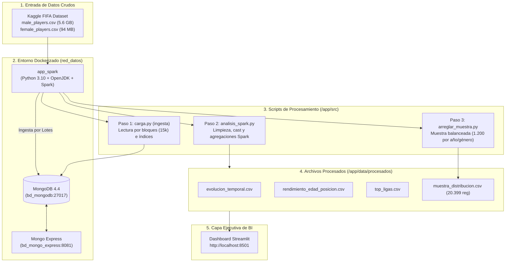

# Telemetría y Análisis Multianual de Rendimiento Deportivo y Brecha Económica en EA Sports FIFA (15–23)

**Proyecto Final · Análisis de Datos Masivos (Big Data)**  
**Autor:** Adrián Rocha  
**Fecha:** Noviembre de 2026  
**Stack Tecnológico:** Docker · Docker Compose · MongoDB 4.4 · Mongo Express · Apache Spark 3.5 (PySpark) · Streamlit · Plotly Express


**Dashboard Interactivo Depslegado en la Nube de Streamlit (Streamlit Community Cloud)** https://fifa-analytics-rocha.streamlit.app/
---

## 1. Descripción del Proyecto

Este repositorio contiene la arquitectura distribuida, contenerizada y reproducible para la ingesta, limpieza, agregación analítica y visualización interactiva de más de **un millón de registros** históricos del fútbol profesional masculino y femenino (ediciones FIFA 15 a 23).

El sistema resuelve cuellos de botella de memoria y problemas de esquemas heterogéneos desacoplando:
1. **Persistencia NoSQL:** Ingesta por lotes (*chunking*) e indexación en **MongoDB**.
2. **Cómputo Distribuido:** Estandarización de tipos, imputación controlada de nulos y agregaciones con **Apache Spark (PySpark)**.
3. **Muestreo Estratificado:** Extracción balanceada de 20.399 registros representativos multianuales.
4. **Capa de BI & Presentación:** Dashboard ejecutivo reactivo en **Streamlit** con gráficos vectoriales en **Plotly Express**.

---

## 2. Arquitectura de la Solución



---

## 3. Estructura del Repositorio

```text
analisis_proyecto_adrian_rocha/
├── .env.example                 # Plantilla de variables de entorno para Docker
├── .env                         # Variables de entorno locales (credenciales y puertos)
├── .gitignore                   # Exclusión de CSVs masivos, caché y secretos
├── docker-compose.yml           # Orquestador multi-contenedor (redes, volúmenes, servicios)
├── requirements.txt             # Dependencias Python del contenedor de análisis
├── README.md                    # Guía técnica y manual de reproducción en español
├── dashboard/
│   └── app.py                   # Aplicación interactiva Streamlit + Plotly (4 KPIs, 6 gráficos)
├── data/
│   ├── male_players.csv         # [Entrada] Dataset masculino FIFA 15 a 23 (>5 GB)
│   ├── female_players.csv       # [Entrada] Dataset femenino FIFA 16 a 23 (~94 MB)
│   └── procesados/              # [Salida] Métricas analíticas generadas
│       ├── evolucion_temporal.csv
│       ├── rendimiento_edad_posicion.csv
│       ├── top_ligas.csv
│       └── muestra_distribucion.csv  # 20.399 registros limpios y equilibrados
├── docker/
│   └── Dockerfile               # Imagen base Python 3.10-slim + OpenJDK + Spark
└── src/
    ├── carga.py                 # Ingesta masiva optimizada hacia MongoDB con índices (ingesta.py en informe)
    ├── analisis_spark.py        # Procesamiento analítico distribuido con PySpark
    └── arreglar_muestra.py      # Muestreo estratificado por bloques para el dashboard
```

---

## 4. Requisitos Previos

1. **Docker Engine y Docker Compose:**
   - [Docker Desktop](https://www.docker.com/products/docker-desktop/) (Windows / macOS) o Docker Engine + Compose plugin (Linux).
2. **Recursos de Hardware Recomendados:**
   - Mínimo **8 GB de RAM** física (PySpark está configurado para consumir 4 GB de memoria de driver y ejecutor).
   - Al menos **15 GB de espacio libre en disco** para hospedar los datasets crudos y volúmenes de MongoDB.
3. **Conjunto de Datos (Dataset de Entrada):**
   - Descargar los archivos `male_players.csv` y `female_players.csv` desde [Kaggle: EA Sports FIFA Complete Player Dataset (Stefano Leone)](https://www.kaggle.com/datasets/stefanoleone992/fifa-23-complete-player-dataset).
   - Colocarlos dentro del directorio `data/`.

---

## 5. Configuración de Variables de Entorno (`.env`)

Para evitar "quemar" credenciales en el código y garantizar la seguridad del proyecto, se utiliza un archivo `.env`.

1. Generar el archivo local `.env` a partir de la plantilla:
   - **En Windows (PowerShell):**
     ```powershell
     Copy-Item .env.example .env
     ```
   - **En Linux / macOS (Bash):**
     ```bash
     cp .env.example .env
     ```

2. Contenido predeterminado del archivo `.env`:
   ```env
   # Credenciales de MongoDB
   MONGO_INITDB_ROOT_USERNAME=admin
   MONGO_INITDB_ROOT_PASSWORD=password123
   MONGO_PORT=27017

   # Base de datos y colección
   MONGO_DB_NAME=fifa_analytics_db
   MONGO_COLLECTION=jugadores

   # Mongo Express (Consola Web)
   MONGO_EXPRESS_PORT=8081

   # Streamlit (Dashboard Ejecutivo)
   STREAMLIT_PORT=8501
   ```

---

## 6. Guía de Ejecución Paso a Paso

### Paso 1: Levantar los contenedores en segundo plano
Construye la imagen personalizada de PySpark, crea la red virtual `red_datos` y los volúmenes de persistencia:

```bash
docker compose up -d
```
*(O `docker-compose up -d` en sistemas con versiones anteriores).*

### Paso 2: Verificar el estado de los contenedores
Confirmar que los 3 contenedores (`bd_mongodb`, `bd_mongo_express`, `app_spark`) estén en estado **Up**:

```bash
docker compose ps
```

---

### Paso 3: Ingesta Masiva en MongoDB
Carga los datos crudos filtrando las 18 columnas principales en lotes de 15.000 filas para evitar saturar la RAM y genera índices sobre `fifa_version`, `gender`, `overall` y `league_name`:

```bash
docker exec -it app_spark python3 /app/src/carga.py
```

> **Nota para evaluación / informe:** Este script realiza la extracción y carga documental en MongoDB documentada en el informe como `ingesta.py`. Se mantiene como `carga.py` en el repositorio de trabajo.

---

### Paso 4: Procesamiento Distribuido con Apache Spark (PySpark)
Ejecuta la limpieza, estandarización de tipos (`cast`), imputación de valores faltantes financieros (`fillna`), agrupación por posición táctica (`primary_position`) y calcula las tablas agregadas multianuales:

```bash
docker exec -it app_spark python3 /app/src/analisis_spark.py
```

Este script materializa en `/app/data/procesados/`:
- `evolucion_temporal.csv`
- `rendimiento_edad_posicion.csv`
- `top_ligas.csv`

---

### Paso 5: Generación de Muestra Estratificada y Equilibrada
Extrae exactamente 1.200 registros por temporada (FIFA 15 a 23) y por género mediante lectura en bloques (`chunksize=25000`), filtrando valores atípicos y asegurando 20.399 registros representativos para el dashboard:

```bash
docker exec -it app_spark python3 /app/src/arreglar_muestra.py
```

---

### Paso 6: Lanzar el Dashboard Interactivo de Streamlit
Despliega el servidor web de analítica en el puerto 8501:

```bash
docker exec -it app_spark streamlit run /app/dashboard/app.py --server.port=8501 --server.address=0.0.0.0
```

---

## 7. Acceso a los Servicios Web

Una vez completados los pasos anteriores, acceda desde su navegador web:

| Servicio | URL Local | Descripción |
| :--- | :--- | :--- |
| **Dashboard Streamlit** | [http://localhost:8501](http://localhost:8501) | Tablero interactivo con 4 KPIs y 6 gráficos vectoriales |
| **Mongo Express** | [http://localhost:8081](http://localhost:8081) | Consola web administrativa para auditar documentos e índices |
| **MongoDB Daemon** | `localhost:27017` | Puerto de conexión de base de datos directa (Compass / DBeaver) |

---

## 8. Detalle del Dashboard Ejecutivo (Streamlit + Plotly)

El dashboard cuenta con filtros dinámicos laterales (por **Temporada**, **Género** y **Posición**) y presenta:

### Tarjetas KPI Principales:
1. **Registros Evaluados:** 20.399 observaciones balanceadas.
2. **Calidad Media (Overall):** 72.3 / 99 puntos globales.
3. **Valor Promedio de Mercado:** € 2.412.717.
4. **Salario Semanal Promedio:** € 8.308.

### 6 Visualizaciones Vectoriales:
1. **Tendencia de Cotización Promedio (€):** Líneas multianuales comparativas Masculino vs. Femenino.
2. **Brecha Salarial Promedio (€):** Barras agrupadas por temporada y rama competitiva.
3. **Distribución de Calificación por Posición:** Diagramas de cajas (*Boxplot*) agrupados por Portero, Defensa, Centrocampista y Delantero.
4. **Curva de Rendimiento por Etapa de Carrera:** Barras etarias (Juvenil 16-20, Promesa 21-24, Plenitud 25-29, Veterano 30+).
5. **Proporción de Pie Hábil:** Gráfico tipo dona mostrando la asimetría 78.4% diestros vs. 21.6% zurdos.
6. **Top 10 Ligas con Mayor Nivel Deportivo:** Barras horizontales ordenadas por *Overall* medio.

---

## 9. Comandos Útiles y Solución de Problemas

- **Reiniciar el contenedor de Spark/Streamlit (liberar memoria RAM):**
  ```bash
  docker restart app_spark
  ```
- **Ver logs en tiempo real de un contenedor:**
  ```bash
  docker compose logs -f app_spark
  ```
- **Detener completamente la infraestructura:**
  ```bash
  docker compose down
  ```
- **Detener y borrar volúmenes de base de datos (reinicio limpio total):**
  ```bash
  docker compose down -v
  ```

---

## 10. Referencias Técnicas
- **Apache Spark Documentation (PySpark 3.5):** [https://spark.apache.org/docs/latest/api/python/](https://spark.apache.org/docs/latest/api/python/)
- **Docker & Docker Compose Reference:** [https://docs.docker.com/compose/](https://docs.docker.com/compose/)
- **MongoDB Manual & Aggregation Pipeline:** [https://www.mongodb.com/docs/manual/](https://www.mongodb.com/docs/manual/)
- **Streamlit Documentation:** [https://docs.streamlit.io/](https://docs.streamlit.io/)
- **Kaggle EA Sports FIFA Complete Player Dataset:** [https://www.kaggle.com/datasets/stefanoleone992/fifa-23-complete-player-dataset](https://www.kaggle.com/datasets/stefanoleone992/fifa-23-complete-player-dataset)

